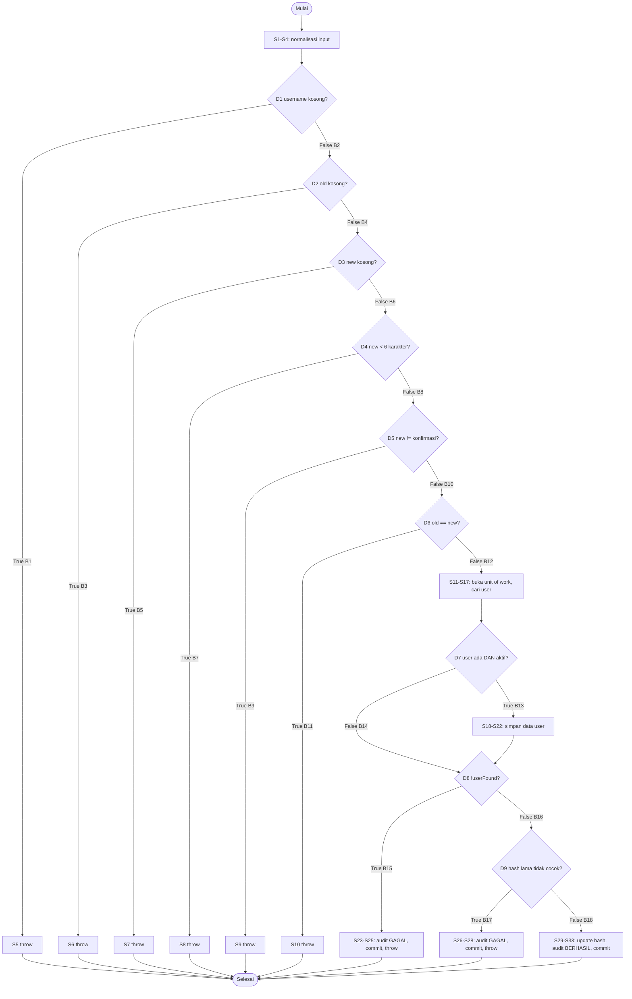

# Laporan White-Box Testing: Reset Password (Verifikasi Password Lama)

- Project: Apotek Firdan Farma (C# WinForms, .NET Framework 4.8, SQLite)
- Fitur: `AuthService.ResetPasswordWithOldPassword` ([Services/AuthService.cs](../Services/AuthService.cs))
- Branch: `testing`
- URL Issue: https://github.com/kurirmandalika/FirdanFarma-praktikum-/issues/1
- URL Commit Unit Testing: https://github.com/kurirmandalika/FirdanFarma-praktikum-/commit/5b88a4875556eb34a5d843be8aa15e0e8860b636

---

## A. PRE-LAB: Analisis Manual (tanpa kode test)

### 1. Source code dengan label statement

Aturan: komentar, deklarasi method, dan kurung kurawal tidak dihitung. Kondisi `if` dilabeli **D** (decision), bukan S.

**Catatan refactor (Lab):** listing di bawah adalah overload `internal` yang benar-benar diuji. Logika dan decision **tidak berubah** dari versi awal (urutan validasi D1-D6, D7 user ada dan aktif, D8, D9, urutan audit dan commit). Yang diabstraksi hanya akses data (`Database.Open()`, `SQLiteCommand`, `AuditService`, `PasswordHasher`, `DateTime.Now`) menjadi `IAuthUnitOfWork`, `IUserRepository`, `IAuditLogger`, `IPasswordHasher`, `IClock`. Karena kode SQL pindah ke adapter, jumlah statement turun dari 40 (versi awal, sebelum refactor) menjadi 33. Jumlah decision (9) dan branch (18) tetap.

```csharp
internal static void ResetPasswordWithOldPassword(string username, string oldPassword, string newPassword, string confirmPassword,
    Func<IAuthUnitOfWork> uowFactory, IPasswordHasher hasher, IClock clock)
{
    username = (username ?? "").Trim();                      // S1
    oldPassword = oldPassword ?? "";                         // S2
    newPassword = newPassword ?? "";                         // S3
    confirmPassword = confirmPassword ?? "";                 // S4

    if (string.IsNullOrWhiteSpace(username))                 // D1
        throw new InvalidOperationException("Username wajib diisi.");                      // S5
    if (string.IsNullOrWhiteSpace(oldPassword))              // D2
        throw new InvalidOperationException("Password sebelumnya wajib diisi.");           // S6
    if (string.IsNullOrWhiteSpace(newPassword))              // D3
        throw new InvalidOperationException("Password baru wajib diisi.");                 // S7
    if (newPassword.Length < 6)                              // D4
        throw new InvalidOperationException("Password baru minimal 6 karakter.");          // S8
    if (newPassword != confirmPassword)                      // D5
        throw new InvalidOperationException("Konfirmasi password baru tidak cocok.");      // S9
    if (oldPassword == newPassword)                          // D6
        throw new InvalidOperationException("Password baru tidak boleh sama dengan password sebelumnya."); // S10

    using (var uow = uowFactory())                           // S11
    {
        long userId = 0;                                     // S12
        string displayName = null;                           // S13
        string role = null;                                  // S14
        string currentHash = null;                           // S15
        bool userFound = false;                              // S16

        var user = uow.Users.FindByUsername(username);       // S17
        if (user != null && user.IsActive)                   // D7
        {
            userFound = true;                                // S18
            userId = user.Id;                                // S19
            displayName = user.DisplayName;                  // S20
            role = user.Role;                                // S21
            currentHash = user.PasswordHash;                 // S22
        }

        if (!userFound)                                      // D8
        {
            uow.Audit.Log(new AuditEntry                     // S23
            {
                Action = "RESET_PASSWORD", Entity = "user",
                Reason = "Username tidak ditemukan/nonaktif", Notes = "Reset password gagal", Status = "GAGAL",
                UsernameOverride = username
            });
            uow.Commit();                                    // S24
            throw new InvalidOperationException("Username tidak ditemukan atau akun nonaktif.");  // S25
        }

        if (!hasher.Verify(oldPassword, currentHash))        // D9
        {
            uow.Audit.Log(new AuditEntry                     // S26
            {
                Action = "RESET_PASSWORD", Entity = "user", EntityId = userId, ReferenceCode = username,
                Reason = "Password sebelumnya salah", Notes = "Reset password gagal", Status = "GAGAL",
                UsernameOverride = username, RoleOverride = role
            });
            uow.Commit();                                    // S27
            throw new InvalidOperationException("Password sebelumnya salah.");   // S28
        }

        var now = clock.Now.ToString("s");                   // S29
        uow.Users.UpdatePasswordHash(userId, hasher.Hash(newPassword), now);   // S30

        var dummyUser = new AppUser { Id = userId, Username = username, DisplayName = displayName, Role = role };  // S31
        uow.Audit.Log(new AuditEntry                         // S32
        {
            User = dummyUser, Action = "RESET_PASSWORD", Entity = "user", EntityId = userId, ReferenceCode = username,
            NewValue = "Password berhasil diperbarui via verifikasi password sebelumnya",
            Notes = "Reset password berhasil", Status = "BERHASIL"
        });
        uow.Commit();                                        // S33
    }
}
```

**Total statement executable: 33** (S1 sampai S33).

### 2. Tabel decision point

| Decision | Kondisi | Branch True | Branch False |
|---|---|---|---|
| D1 | `IsNullOrWhiteSpace(username)` | B1: lempar "Username wajib diisi" | B2: lanjut ke D2 |
| D2 | `IsNullOrWhiteSpace(oldPassword)` | B3: lempar "Password sebelumnya wajib diisi" | B4: lanjut ke D3 |
| D3 | `IsNullOrWhiteSpace(newPassword)` | B5: lempar "Password baru wajib diisi" | B6: lanjut ke D4 |
| D4 | `newPassword.Length < 6` | B7: lempar "minimal 6 karakter" | B8: lanjut ke D5 |
| D5 | `newPassword != confirmPassword` | B9: lempar "Konfirmasi tidak cocok" | B10: lanjut ke D6 |
| D6 | `oldPassword == newPassword` | B11: lempar "tidak boleh sama" | B12: buka DB, query user |
| D7 | `user != null && user.IsActive` | B13: user ketemu dan aktif, `userFound = true` | B14: user `null` atau `IsActive = false` |
| D8 | `!userFound` | B15: audit GAGAL, commit, lempar "tidak ditemukan" | B16: lanjut ke D9 |
| D9 | `!PasswordHasher.Verify(old, hash)` | B17: audit GAGAL, commit, lempar "password salah" | B18: update password dan audit BERHASIL |

**Total decision = 9, total branch = 18.**
Catatan: D7 adalah kondisi majemuk (`&&`). Secara branch tetap 2 cabang, tetapi False bisa terjadi karena 2 sebab berbeda (user `null`, atau akun nonaktif). Operator `??` pada S1-S4 tidak dihitung sebagai decision manual (lihat bagian perbandingan dengan coverage tool).

### 3. Control Flow Graph dan Cyclomatic Complexity



**V(G) = jumlah decision + 1 = 9 + 1 = 10.**
Cek dengan rumus E - N + 2P pada diagram di atas: N = 23 simpul (START, N1, D1-D9, S5-S10, N2-N6, END), E = 31 sisi, P = 1, sehingga 31 - 23 + 2 = **10**. Hasilnya sama dengan rumus sederhana.

Daftar independent path:

| Path | Jalur | Keterangan |
|---|---|---|
| P1 | D1(T) → S5 | username kosong |
| P2 | D1(F) → D2(T) → S6 | password lama kosong |
| P3 | D1(F) → D2(F) → D3(T) → S7 | password baru kosong |
| P4 | ... D3(F) → D4(T) → S8 | password baru kurang dari 6 |
| P5 | ... D4(F) → D5(T) → S9 | konfirmasi tidak cocok |
| P6 | ... D5(F) → D6(T) → S10 | password baru sama dengan lama |
| P7 | ... D6(F) → D7(F) → D8(T) → S23-S25 | user tidak ditemukan / nonaktif |
| P8 | ... D7(T) → D8(F) → D9(T) → S26-S28 | password lama salah |
| P9 | ... D7(T) → D8(F) → D9(F) → S29-S33 | sukses |
| P10 | D7(T) → D8(T) | **tidak feasible**: D8 adalah kebalikan D7 (`userFound` hanya true kalau D7 true) |

Jadi V(G) = 10, tetapi hanya **9 path yang bisa dieksekusi**. Ini temuan analisis: ada redundansi D7 dan D8.

### 4. Test case Statement Coverage (set minimal)

Setiap `throw` mengakhiri method, jadi tiap statement `throw` butuh test case sendiri. Karena itu set minimal berisi 9 TC.

| TC | Input (username, old, new, confirm; kondisi DB) | Statement yang dieksekusi | Expected output |
|---|---|---|---|
| TC1 | `""`, `"lama123"`, `"baru123"`, `"baru123"` | S1-S4, S5 | `InvalidOperationException("Username wajib diisi.")` |
| TC2 | `"kasir"`, `""`, `"baru123"`, `"baru123"` | S1-S4, S6 | `InvalidOperationException("Password sebelumnya wajib diisi.")` |
| TC3 | `"kasir"`, `"lama123"`, `""`, `""` | S1-S4, S7 | `InvalidOperationException("Password baru wajib diisi.")` |
| TC4 | `"kasir"`, `"lama123"`, `"abc"`, `"abc"` | S1-S4, S8 | `InvalidOperationException("Password baru minimal 6 karakter.")` |
| TC5 | `"kasir"`, `"lama123"`, `"baru123"`, `"beda999"` | S1-S4, S9 | `InvalidOperationException("Konfirmasi password baru tidak cocok.")` |
| TC6 | `"kasir"`, `"lama123"`, `"lama123"`, `"lama123"` | S1-S4, S10 | `InvalidOperationException("Password baru tidak boleh sama ...")` |
| TC7 | `"hantu"`, `"lama123"`, `"baru123"`, `"baru123"`; user tidak ada di DB | S1-S4, S11-S17, S23-S25 | `InvalidOperationException("Username tidak ditemukan atau akun nonaktif.")`, audit GAGAL tercatat |
| TC8 | `"kasir"`, `"salah!"`, `"baru123"`, `"baru123"`; user aktif, hash tidak cocok | S1-S4, S11-S22, S26-S28 | `InvalidOperationException("Password sebelumnya salah.")`, audit GAGAL tercatat |
| TC9 | `"kasir"`, `"lama123"`, `"baru123"`, `"baru123"`; user aktif, hash cocok | S1-S4, S11-S22, S29-S33 | Tidak ada exception, hash diganti, audit BERHASIL tercatat |

Gabungan statement dieksekusi: S1-S4, S5-S10 (TC1-6), S11-S17 (TC7-9), S18-S22 (TC8, TC9), S23-S25 (TC7), S26-S28 (TC8), S29-S33 (TC9) = **33 statement**.

**Statement Coverage = 33 / 33 × 100% = 100%** (dengan 9 TC).

### 5. Test case Branch Coverage

| TC | Input | Branch yang dilewati | Expected output |
|---|---|---|---|
| TC1 | username kosong | D1: B1 | exception "Username wajib diisi." |
| TC2 | old kosong | D1: B2, D2: B3 | exception "Password sebelumnya wajib diisi." |
| TC3 | new kosong | B2, B4, D3: B5 | exception "Password baru wajib diisi." |
| TC4 | new = `"abc"` | B2, B4, B6, D4: B7 | exception "minimal 6 karakter" |
| TC5 | konfirmasi beda | B2, B4, B6, B8, D5: B9 | exception "Konfirmasi ... tidak cocok" |
| TC6 | old sama dengan new | B2, B4, B6, B8, B10, D6: B11 | exception "tidak boleh sama" |
| TC7 | user tidak ada | B2, B4, B6, B8, B10, B12, D7: B14, D8: B15 | exception "tidak ditemukan atau akun nonaktif" |
| TC8 | password lama salah | B12, B13, B16, D9: B17 | exception "Password sebelumnya salah." |
| TC9 | semua valid | B12, B13, B16, B18 | sukses tanpa exception |

Gabungan branch: B1-B18 semuanya terlewati.

**Branch Coverage = 18 / 18 × 100% = 100%** (dengan 9 TC yang sama).

Test case tambahan (bukan untuk coverage, untuk kualitas, akan dipakai di Lab):

| TC | Tujuan | Input | Expected |
|---|---|---|---|
| TC10 | Boundary panjang password | new = `"12345"` (5 karakter) | exception minimal 6 karakter |
| TC11 | Boundary panjang password | new = `"123456"` (6 karakter) | lolos D4 |
| TC12 | Sisi kedua kondisi D7 | user ada tetapi `IsActive = false` | exception "tidak ditemukan atau akun nonaktif" |
| TC13 | Input null | semua parameter `null` | exception "Username wajib diisi." |
| TC14 | Username berisi spasi | `"  kasir  "` | di-trim, diperlakukan sebagai `"kasir"` |

### 6. Analisis: 100% statement coverage belum tentu 100% branch coverage

**Konsep:** statement coverage hanya bertanya "apakah baris ini pernah jalan?". Branch coverage bertanya "apakah setiap arah keputusan (True dan False) pernah diambil?". Sebuah `if` tanpa `else` punya cabang False yang tidak punya statement sendiri, jadi cabang itu bisa terlewat tanpa menurunkan statement coverage.

**Contoh konkret di fitur ini:**

1. Di fitur ini setiap `if` adalah *guard* + `throw`, sehingga statement coverage dan branch coverage selalu naik bersamaan.
2. Perbedaan terlihat di **kondisi majemuk D7**: `r.Read() && is_active == 1`. TC7 (user tidak ada) sudah membuat D7 False dan mengeksekusi S23-S25, sehingga statement coverage dan branch coverage sudah 100% **tanpa pernah menguji akun nonaktif** (`is_active != 1`). Jika seseorang mengubah `== 1` menjadi `>= 0`, 9 TC di atas tetap lulus semua padahal akun nonaktif bisa reset password. Inilah alasan TC12 ditambahkan. Metrik 100%/100% tidak menjamin semua kondisi teruji.
3. Contoh umum untuk kasus lain: pada `if (x) { A(); }` tanpa else, satu test dengan `x = true` sudah menjalankan semua statement (100% statement) tetapi baru satu dari dua branch (50% branch).

**Kesimpulan:** branch coverage lebih kuat daripada statement coverage, tetapi keduanya tetap tidak menjamin kondisi majemuk dan nilai batas teruji. Karena itu test case tambahan TC10-TC14 diperlukan.

---

---

## B. LAB SESSION: Unit Testing

### B.1 Framework dan coverage tool

| Komponen | Pilihan | Alasan |
|---|---|---|
| Framework test | xUnit 2.9.2 (net48) | Mendukung .NET Framework 4.8. Satu instance test class per test, jadi tidak ada state yang bocor antar test. |
| Library test double | Moq 4.18.4 (versi dipin) | Dipakai untuk Mock dan verifikasi urutan panggilan. Versi 4.20.0 memuat SponsorLink (dicabut di 4.20.2); versi dipin supaya hasil build konsisten. |
| Coverage tool | Microsoft Code Coverage (`--collect:"Code Coverage;Format=cobertura"`) | Awalnya dicoba `coverlet.collector`, tetapi hasilnya kosong (0 baris) karena coverlet tidak meng-instrument `WinExe` (project ini bertipe `WinExe`). Collector bawaan `Microsoft.NET.Test.Sdk` meng-instrument exe, sehingga dipakai sebagai gantinya. |

Perubahan kode produksi (refactor minimal, perilaku identik): method public `AuthService.ResetPasswordWithOldPassword` tetap sama dan hanya meneruskan ke overload `internal` yang menerima `Func<IAuthUnitOfWork>`, `IPasswordHasher`, `IClock`. Akses data diabstraksi lewat `IAuthUnitOfWork` (transaksi), `IUserRepository`, `IAuditLogger`. Implementasi asli ada di `Services/Abstractions/SqliteAuthAdapters.cs`. `InternalsVisibleTo` ditambahkan untuk project test dan `DynamicProxyGenAssembly2` (dibutuhkan Moq untuk memproksi interface `internal`).

### B.2 Daftar test (15 test)

| # | Nama test | TC Pre-Lab | Skenario | Test double utama |
|---|---|---|---|---|
| 1 | `ResetPassword_UsernameKosong_MelemparUsernameWajibDiisi` | TC1 | Negatif | Dummy |
| 2 | `ResetPassword_PasswordLamaKosong_MelemparPasswordSebelumnyaWajibDiisi` | TC2 | Negatif | Dummy |
| 3 | `ResetPassword_PasswordBaruKosong_MelemparPasswordBaruWajibDiisi` | TC3 | Negatif | Dummy |
| 4 | `ResetPassword_PasswordBaruTigaKarakter_MelemparMinimalEnamKarakter` | TC4 | Negatif | Dummy |
| 5 | `ResetPassword_KonfirmasiBeda_MelemparKonfirmasiTidakCocok` | TC5 | Negatif | Dummy |
| 6 | `ResetPassword_PasswordBaruSamaDenganLama_MelemparTidakBolehSama` | TC6 | Negatif | Dummy |
| 7 | `ResetPassword_UserTidakAda_MencatatAuditGagalLaluCommitLaluMelempar` | TC7 | Negatif | Mock |
| 8 | `ResetPassword_PasswordLamaSalah_MencatatAuditGagalLaluCommitLaluMelemparDanTidakMengubahHash` | TC8 | Negatif | Mock + Stub |
| 9 | `ResetPassword_DataValid_UpdateHashLaluAuditBerhasilLaluCommit` | TC9 | Positif | Mock + Stub |
| 10 | `ResetPassword_DataValid_HashDiRepositoryBerubahDanPasswordBaruBisaDiverifikasi` | TC9 (versi state) | Positif | Fake (+ Spy) |
| 11 | `ResetPassword_PasswordBaruLimaKarakter_DitolakKarenaKurangDariEnam` | TC10 | Boundary | Dummy |
| 12 | `ResetPassword_PasswordBaruTepatEnamKarakter_DiterimaDanTersimpan` | TC11 | Boundary | Fake |
| 13 | `ResetPassword_AkunNonaktif_DitolakDenganAuditGagalDanTidakMengubahPassword` | TC12 | Negatif | Stub + Spy |
| 14 | `ResetPassword_SemuaParameterNull_DianggapKosongDanDitolakDiUsername` | TC13 | Negatif | Dummy |
| 15 | `ResetPassword_UsernameBerspasi_DiTrimLaluDitemukan` | TC14 | Positif | Fake (+ Spy) |

Seluruh TC1-TC14 terwakili. Menurut jenis skenario: positif 3 test (#9, #10, #15), negatif 10 test, boundary 2 test (#11, #12).

### B.3 Pola Arrange-Act-Assert (AAA)

Setiap test memakai tiga bagian bertanda komentar `// Arrange`, `// Act`, `// Assert`. Contoh yang dibedah: test #9 (TC9, jalur sukses, memakai Mock).

```csharp
[Fact] // TC9 | positif | D7-True -> D8-False -> D9-False (B13, B16, B18)
public void ResetPassword_DataValid_UpdateHashLaluAuditBerhasilLaluCommit()
{
    // Arrange
    var m = new MockSet(Kasir());
    var hasher = new StubPasswordHasher(verifyResult: true);

    // Act
    Reset("kasir", "lama123", "baru123", "baru123", () => m.Uow.Object, hasher, new StubClock());

    // Assert
    Assert.Equal(new[] { "UpdatePasswordHash", "Audit.Log:BERHASIL", "Commit" }, m.Calls);
    m.Users.Verify(u => u.UpdatePasswordHash(7L, "HASH-BARU", "2026-01-15T10:00:00"), Times.Once());
    // ... assert isi audit (Status, EntityId, ReferenceCode, Notes)
}
```

| Fase | Isi |
|---|---|
| Arrange | Menyiapkan akun `kasir` (aktif), Mock unit of work yang mencatat urutan panggilan, Stub hasher (`Verify` selalu `true`, `Hash` selalu `"HASH-BARU"`), dan Stub clock (waktu tetap). Tidak ada database. |
| Act | Satu aksi: memanggil `ResetPasswordWithOldPassword` dengan data valid. |
| Assert | Memeriksa urutan panggilan tepat `UpdatePasswordHash`, lalu `Audit.Log:BERHASIL`, lalu `Commit`; argumen `UpdatePasswordHash` (id 7, hash baru, waktu format `"s"`); jumlah panggilan (`Times.Once`); dan isi audit. |

### B.4 Tabel test double

| Jenis | Menggantikan dependency apa | Dipakai di test mana | Alasan pemilihan |
|---|---|---|---|
| **Dummy** (`Dummies.UnitOfWorkFactory`, `DummyPasswordHasher`, `DummyClock`) | `Func<IAuthUnitOfWork>`, `IPasswordHasher`, `IClock` | #1-#6, #11, #14 (TC1-TC6, TC10, TC13); hasher Dummy juga di #7 dan #13 | Enam validasi pertama harus berhenti sebelum membuka database. Dummy melempar `NotSupportedException` kalau disentuh, sehingga test lulus hanya jika validasi benar-benar berhenti lebih awal. Sebagai hasher di TC7 dan TC12, ia membuktikan alur berhenti di D8 sebelum `Verify` (D9). |
| **Stub** (`StubUserRepository`, `StubPasswordHasher`, `StubClock`) | `IUserRepository.FindByUsername`, `IPasswordHasher`, `IClock` | #8, #9, #13 (TC8, TC9, TC12) | Cabang D7 dan D9 perlu jawaban yang bisa dikendalikan: akun nonaktif untuk TC12, `Verify=false` untuk TC8. Waktu dikunci supaya nilai `nowIso` bisa dibandingkan persis. Tidak perlu diverifikasi, hanya memberi input. |
| **Mock** (Moq: `Mock<IAuthUnitOfWork>`, `Mock<IUserRepository>`, `Mock<IAuditLogger>`) | Transaksi, repository, dan audit logger | #7, #8, #9 (TC7, TC8, TC9) | Kewajiban terpenting fitur ini adalah urutan efek samping: gagal = audit GAGAL, Commit, lalu throw; sukses = UpdatePasswordHash, audit BERHASIL, lalu Commit. Hasil kembalian method tidak membuktikan itu, jadi perlu verifikasi interaksi (`Verify`, `Times`) dan urutan lewat callback yang mencatat panggilan. |
| **Fake** (`FakeUserRepository`, `FakePasswordHasher`, `FakeUnitOfWork`) | Tabel `users` SQLite dan `PasswordHasher` PBKDF2 | #10, #12, #15 (TC9 versi state, TC11, TC14) | Untuk memeriksa state akhir (hash tersimpan berubah, password baru lolos `Verify`, password lama tidak), diperlukan penyimpanan yang benar-benar bekerja tetapi ringan. Fake berupa dictionary in-memory, jadi tidak bergantung pada SQLite atau waktu hashing 120.000 iterasi. |
| **Spy** (`SpyAuditLogger`, `SpyUserRepository`, `SpyUnitOfWork`) | `IAuditLogger`, `IUserRepository`, `IAuthUnitOfWork` | #13 (TC12), plus bagian `AuditEntries`/`Committed` pada Fake di #10 dan #15 | TC12 hanya perlu mencatat apa yang terjadi lalu memeriksanya setelah Act: tepat satu audit GAGAL, Commit satu kali, `UpdatePasswordHash` nol kali. Tidak ada ekspektasi yang diset di depan seperti Mock. |

Contoh utama untuk presentasi (ditandai `// [CONTOH UTAMA: ...]` di kode): Dummy = TC1 (#1), Stub dan Spy = TC12 (#13), Mock = TC9 (#9), Fake = TC9 versi state (#10).

### B.5 Hasil run dan coverage

Perintah (dari root repo) dan tempat mengambil screenshot:

```powershell
# 1. Semua test (screenshot: ringkasan "Passed! - Failed: 0, Passed: 15")
dotnet test ApotekFirdanFarma.Tests --logger "console;verbosity=normal"

# 2. Test + coverage (screenshot: baris "Attachments: ...cobertura.xml")
dotnet test ApotekFirdanFarma.Tests --collect:"Code Coverage;Format=cobertura" --results-directory ApotekFirdanFarma.Tests/TestResults
```

Hasil run: **15 test, 15 lulus, 0 gagal.**

Coverage dibaca dari file cobertura per **method** `ResetPasswordWithOldPassword` (overload internal), bukan per file `AuthService.cs`:

| Metrik | Hasil |
|---|---|
| Line coverage | 100% (65 dari 65 baris) |
| Branch coverage | 100% (28 dari 28 branch) |
| Wrapper public 4-argumen | 0% (tidak ikut unit test, diverifikasi lewat uji manual B.8) |

### B.6 Perbandingan coverage manual vs tool

| Metrik | Manual (Pre-Lab) | Tool | Penjelasan selisih |
|---|---|---|---|
| Statement / line | 33 statement, 100% | 65 baris, 100% | Tool mengukur baris fisik, bukan statement. Object initializer multi-baris (`new AuditEntry { ... }`) dihitung beberapa line. Keduanya 100%. |
| Branch | 18 branch, 100% | 28 branch, 100% | Tool menghitung branch dari IL hasil compile: 8 branch dari 4 operator `??` di S1-S4 (masing-masing 2 cabang), dan 2 branch tambahan dari `&&` di D7 (tool menghitung 4 cabang untuk `user != null && user.IsActive`, manual 2). Tambahan 10, sehingga 18 + 10 = 28. D1-D6, D8, D9 sama (2 cabang masing-masing). |

Kesimpulan: kedua cara sampai pada 100%, hanya satuan hitungnya yang berbeda. Cabang tambahan dari `??` dan `&&` itu juga menunjukkan bahwa D7 dan input `null` memang perlu diuji (TC12 dan TC13).

### B.7 Temuan

- **Bug di kode produksi:** tidak ada.
- **Temuan analisis:** D8 (`!userFound`) hanya kebalikan D7, jadi path P10 (D7 benar dan D8 benar) tidak mungkin dieksekusi. Ini bukan bug, hanya redundansi struktur.
- **Temuan tooling:** `coverlet.collector` tidak bisa meng-instrument project `WinExe` (hasil kosong), diganti Microsoft Code Coverage. Moq butuh `InternalsVisibleTo("DynamicProxyGenAssembly2")` untuk memproksi interface `internal`.
- **Temuan konfigurasi:** `.gitignore` awal berisi sisa perintah PowerShell (`@"` dan `"@ | Set-Content .gitignore`). Sudah dibersihkan dan ditambah `TestResults/`, `coverage/`, `*.coverage`, `*.cobertura.xml`.

### B.8 Uji regresi manual adapter SQLite

Adapter `Sqlite*` dan wrapper public tidak tercakup unit test, jadi diverifikasi manual dengan menjalankan aplikasi (`dotnet run --project ApotekFirdanFarma.csproj`) pada DB yang sudah di-backup, lalu memeriksa tabel `audit_logs`.

| Skenario | Langkah | Hasil di layar | Baris `audit_logs` | Status |
|---|---|---|---|---|
| A. Reset sukses | Reset `apotek01`, password baru `baru123`, lalu login | Pesan berhasil, login `apotek01`/`baru123` berhasil | id 119: `RESET_PASSWORD`, `BERHASIL`, role `KARYAWAN`, notes `Reset password berhasil` (2026-11-24 23:55:00) | Lulus |
| B. Password lama salah | Reset dengan password lama salah | "Password sebelumnya salah" | id 122: `RESET_PASSWORD`, `GAGAL`, role `KARYAWAN`, reason `Password sebelumnya salah` (23:56:08) | Lulus |
| C. Akun nonaktif | `apotek01` dinonaktifkan lewat `alfian`, lalu reset lewat tautan "Lupa / Reset Password?" | "Username tidak ditemukan atau akun nonaktif" | id 130: `RESET_PASSWORD`, `GAGAL`, role kosong, reason `Username tidak ditemukan/nonaktif` (2026-11-25 00:04:25) | Lulus (uji manual) |

Catatan pengujian C:
- Percobaan pertama oleh penguji ternyata lewat tombol MASUK, bukan tautan reset. Hasilnya dua baris `LOGIN GAGAL` (id 127 dan 128, reason `Login ditolak`), bukan `RESET_PASSWORD`. Itu perilaku `AuthService.Login`, bukan fitur yang diuji.
- Untuk memastikan jalur produksi, method public dipanggil lewat test sementara (tidak di-commit) pada kondisi yang sama dan menghasilkan baris id 129 (`RESET_PASSWORD`, `GAGAL`, `Username tidak ditemukan/nonaktif`, 2026-11-25 00:02:04). Baris ini menjadi bukti pendukung. Baris id 130 dari uji manual menegaskan hasil yang sama.
- Pola yang konsisten pada skenario A, B, C: audit tercatat dan di-commit sebelum exception dilempar (GAGAL) atau setelah update password (BERHASIL), sama dengan perilaku sebelum refactor.

### B.9 Bukti dan tautan

- GitHub Issue: https://github.com/kurirmandalika/FirdanFarma-praktikum-/issues/1
- Commit Unit Testing: https://github.com/kurirmandalika/FirdanFarma-praktikum-/commit/5b88a4875556eb34a5d843be8aa15e0e8860b636
